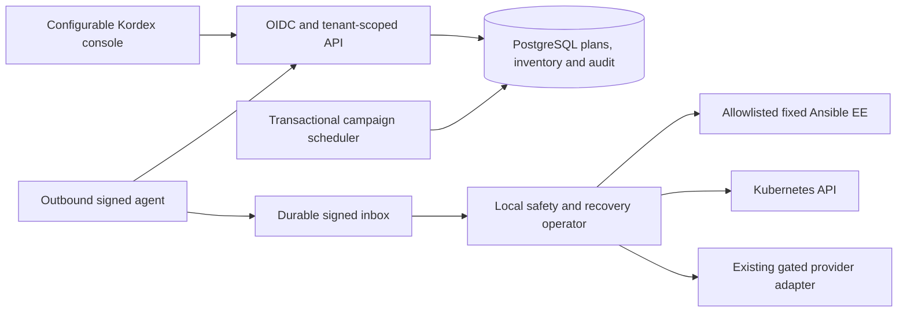

# Kordex Fleet Platform architecture

The existing [hub/spoke architecture](architecture.md) is retained. PostgreSQL
owns organization inventory, plans, approvals, scheduler fencing, reservations
and audit. Agents authenticate outbound reports; the Kubernetes operator owns
the local disruption veto and verified recovery. The dashboard calls the
management API with the user's credential and holds no Kubernetes credentials.

## Capability and driver boundaries

`api/lifecycle` supplies typed operations, support states, host discovery,
immutable compatibility descriptors and validation-only driver selection.
Unknown `ID_LIKE` relationships never select mutation. Package and image models
are distinct; registry entries cannot self-assert qualification. Execution
requests through the new registry are rejected until a qualification-backed
activation mechanism exists. Existing signed APT/DNF/GKE paths are preserved
behind their existing lab-only opt-in gates.

`integrations/lifecycle/drivers.go` separates OS package, image activation and
Kubernetes-native contracts. These interfaces are not new executors. Driver
name/version, artifact SHA-256 and plan SHA-256 have a typed binding model;
wiring that binding into new signed action schemas and durable checkpoints is
still required before any new adapter may execute. Existing action schemas
already bind their fixed catalog, EE artifact and plan digest.

`kordex-discover` reads an explicitly supplied root/snapshot using an `os.Root`
filesystem boundary. It never SSHs, executes a package manager, or assumes a
container filesystem belongs to the host. Missing repository, reboot, disk or
mutability evidence remains unknown. Filesystem discovery does not provide
identity attestation; remote observations need fixed driver probes and receipts.

Kubernetes Node API metadata produces advisory distribution/provider hints with
an explicit source. A cloud VM ID alone does not establish managed Kubernetes.
Hints are stored in the existing node inventory JSON, validated by the API, and
shown in the fleet view. No database migration or new maintenance CRD is needed.
Storage, control-plane and image mutations remain unavailable.

## Rollout and deployment

Upgrade the hub before agents: old reports remain accepted; older strict hubs
will reject the new optional `node.lifecycle` field. Then update agents and the
dashboard. The compatibility endpoint is a read-only, organization-authorized
API and requires no new Kubernetes RBAC, host mounts or credentials. Existing
Helm/Kustomize execution defaults remain off. The runbook's lab-only Helm
override is still the only documented host qualification enablement path.

The execution engine uses open-source Ansible inside pinned containers and
native Kubernetes/provider APIs; Ansible Automation Platform is not required.
Redfish, provisioning, standalone hosts and hypervisor adapters require future
typed models and qualified implementations, not a generic command endpoint.
