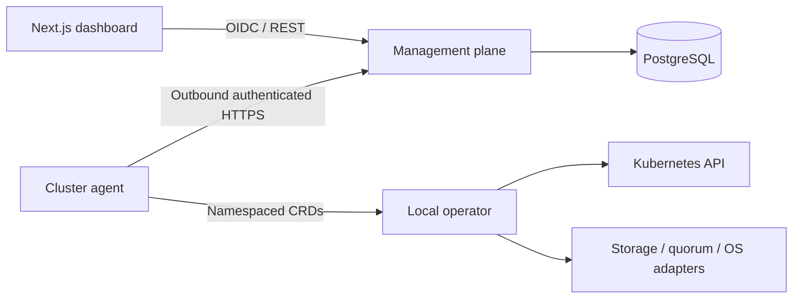

# Architecture

## Implementation boundary

Release 0.2.0 implements the modular Go API, PostgreSQL, OIDC membership authorization, organization/site/fleet/cluster registration, Ed25519 agent identity, heartbeats and node inventory. Shared wire contracts live in the api module; the agent is a separate Go module with Kubernetes client-go. No scheduling, CRDs or host execution is enabled. See agent-protocol.md for exact authentication and recovery semantics.

## Hub and spokes

The hub never requires inbound connectivity to customer Kubernetes APIs. Agents initiate authenticated outbound requests. Start with HTTPS polling and bounded inventory batches; choose gRPC or Pub/Sub only with measured need. Cloud Run can host the stateless API later. A separate leased worker handles long-running scheduling rather than an HTTP request or Cloud Run instance lifetime.

Logical responsibilities remain separate even if one Helm release deploys the agent and operator. The agent owns enrollment, workload identity rotation, inventory and connectivity. Durable command inboxes, acknowledgements and CRD delivery are future work. The current identity model is application-layer Ed25519 signatures over HTTPS rather than mTLS. The operator owns local desired/observed state, disruption safety, reconciliation and recovery. Host actions require a distinct narrowly authorized executor design; a privileged general-purpose shell agent is excluded.

## Persistence and consistency

PostgreSQL is authoritative for management state. Versioned immutable migrations execute as an explicit job, with an advisory transaction lock and checksum validation. Migration 1 creates organizations, sites, audit events and migration metadata. Migration 2 adds fleets, memberships, clusters, enrollment tokens, active agent identities, replay nonces, nodes and audit metadata. Site queries always include organization ID. Fleet/site associations in clusters use composite tenant foreign keys. OIDC request authorization reads subject membership before serving scoped routes. Successful creates and their audit entries commit atomically. UUIDs identify resources and requests. Names have unique constraints. Repeating a create currently returns 409; there are no maintenance command endpoints.

Future tables: fleets, clusters, agent identities, inventory snapshots, policies, campaigns, stage targets, operations, events, approvals, reservations, leases and transactional outbox. Tenant IDs must participate in all relationships and authorization scopes; extend composite constraints before adding shared multi-tenant operations. Fleet/site membership and movable cluster semantics remain open product decisions.

The future scheduler must claim work using `FOR UPDATE SKIP LOCKED` and lease/fencing tokens, reserve organization/fleet/site/cluster/node capacity in one transaction with a consistent lock order, and enforce a unique `(campaign, target, action_generation)` operation constraint. Use a transactional outbox for delivery. No correctness claim rests on a single process or in-memory lock. Reservations expire only through explicit recovery that establishes the target's actual state; lease expiry alone never makes a disrupted node available.

An operation envelope must include protocol version, UUID, tenant/cluster/node immutable IDs, action and parameters digest, approval/policy generation, issued/not-before/expiry times and fencing generation. Local acceptance atomically persists the envelope before acknowledgement. Identical redelivery returns durable status; conflicting reuse, expired authorization and older generations are rejected with audit events. Acknowledgement is not completion. The operator must revalidate authorization and local safety before each disruptive boundary. Exactly-once physical actions cannot be promised: after ambiguous execution, observe durable action markers and node boot ID; never replay a package/reboot action blindly.

## Safety reconciliation (future)

CRDs start at `operations.<owned-domain>/v1alpha1`; the API group domain must be chosen before publication. MaintenancePolicy specifies local safety constraints; MaintenanceCampaign represents local campaign intent; NodeMaintenance represents a single authorized node operation. All have schema validation, conditions, observedGeneration and status subresources. NodeMaintenance status records operation ID, immutable target UID, phase, phase timestamps, action marker, boot IDs, checkpoints, events and failure reason. Use resource-version conflict handling and leader election; status alone is not a distributed lock for host execution.

Planned phases: Pending → Validating → SafetyChecking → Cordoning → Draining → Executing → Rebooting (if needed) → VerifyingNode → VerifyingWorkloads → Uncordoning → Succeeded. Blocked, Paused, Failed and RecoveryRequired are explicit states with reason codes. Persist intent before side effects; observe the effect after restart. Record original schedulability and never uncordon a node that was cordoned before this operation. Only an operator-owned cordon may be restored after verified recovery.

Safety providers return Pass / Block / Unknown with evidence timestamps. Unknown blocks. Workload checks cover node/cluster readiness, unhealthy workloads, failure domains, PDBs, unmanaged pods, local data, DaemonSets, static/mirror pods and non-evictable workloads. Drain uses eviction API; it never silently deletes around PDBs. Missing storage/quorum support for affected nodes blocks maintenance. Non-storage clusters do not require Ceph. Storage adapters expose preflight, enter-maintenance, observe-recovery and exit-maintenance with operation-owned tokens; Ceph/Rook eventually verify health, OSD availability, noout ownership and recovery. Quorum checks require observed membership and topology, not a guessed replica count.

## Campaign semantics (future)

Resolve selectors into a versioned target snapshot, including site/cluster/labels, approval generation and immutable node IDs. Schedule IANA time zones with UTC persisted instants; ambiguous DST times require an explicit chosen instant. Canary → small batch → expanded → remaining stages require policy evidence and gates. Pause stops new authorizations; active recovery continues under local safety. Failure thresholds never auto-advance stages. Retries use new attempt identity linked to the operation and require fresh authorization; recovery actions are explicit, not generic rollback promises. Multiple concurrency scopes and site failure domains apply simultaneously.

## Runtime and scale

Bound request sizes, query sizes, connection pools and deadlines now. Move offset pagination to stable cursors before high-volume inventory; do not apply current admin listings to node telemetry. Track freshness, queue age, blocked reasons, phase latency, reservation usage and audit delivery. Request logs omit credentials and customer payloads; OpenTelemetry exports OTLP/HTTP only when configured. No exporter endpoint means tracing is local and unexported. Log collection and metrics backends are deployment concerns.

Simulator milestone: deterministic synthetic inventory and campaign/safety scenarios at 4,000+ nodes and hundreds of clusters, with latency and memory measurements. Real cluster and VM fault testing is required before capacity or lifecycle safety claims.
