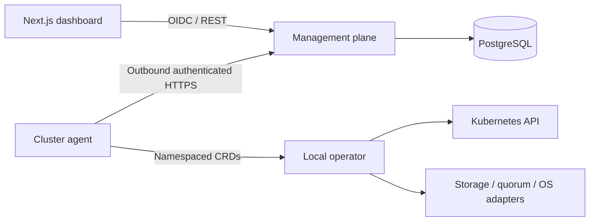

# Architecture

## Implementation boundary

The current release line includes a controller-runtime operator, private v1alpha1 CRDs, manual node-operation APIs and durable signed command delivery to the OIDC/inventory service. ValidateOnly and stateless-worker DrainAndVerify are available by default. A Debian Ansible EE package/reboot path and a GKE node-pool Kubernetes version path are available behind separate opt-in gates, but neither is production-qualified. EKS/AKS, storage mutation, and control-plane maintenance remain unsupported. Durable hub campaigns and a separate PostgreSQL scheduler coordinate supported operations. Exact safety/identity assumptions are in maintenance-operator.md and agent-protocol.md.

## Hub and spokes

The hub never requires inbound connectivity to customer Kubernetes APIs. Agents initiate authenticated outbound requests. Start with HTTPS polling and bounded inventory batches; choose gRPC or Pub/Sub only with measured need. Cloud Run can host the stateless API later. A separate leased worker handles long-running scheduling rather than an HTTP request or Cloud Run instance lifetime.

Logical responsibilities remain separate even if one Helm release deploys the agent and operator. The agent owns enrollment, workload identity rotation, inventory and connectivity. The NodeMaintenance inbox, signed permit delivery and acknowledged sequenced status are implemented. The current identity model is application-layer Ed25519 signatures over HTTPS rather than mTLS. The operator owns local desired/observed state, disruption safety, reconciliation and recovery. Host actions require a distinct narrowly authorized executor design; a privileged general-purpose shell agent is excluded.

## Persistence and consistency

PostgreSQL is authoritative for management state. Versioned immutable migrations execute as an explicit job, with an advisory transaction lock and checksum validation. Migration 1 creates organizations, sites, audit events and migration metadata. Migration 2 adds fleets, memberships, clusters, enrollment tokens, active agent identities, replay nonces, nodes and audit metadata. Site queries always include organization ID. Fleet/site associations in clusters use composite tenant foreign keys. OIDC request authorization reads subject membership before serving scoped routes. Successful creates and their audit entries commit atomically. UUIDs identify resources and requests. Names have unique constraints. Repeating a create currently returns 409. Maintenance command endpoints exist for authorized cancellation and outbound agent synchronization; dashboards expose organization-scoped summary and inventory reads.

Migration 3 adds durable node_operations with one active operation per cluster and append-only sequenced audit updates. Migrations 4–6 add campaign targets, approvals, multi-scope reservations, scheduler leases and query indexes. Tenant IDs participate in relationships and authorization scopes. Fleet/site membership and movable cluster semantics remain open product decisions.

The current scheduler claims targets with `FOR UPDATE SKIP LOCKED`, uses PostgreSQL-backed lease and organization admission locks, and reserves organization/fleet/site/cluster/node capacity transactionally. Campaign target identity is unique by campaign, cluster and node UID; retry attempts have a separate unique target/attempt identity. Agent polling reads durable operations from PostgreSQL, so no broker or outbox is required by the current transport. Any future external delivery transport must add a transactional outbox. No correctness claim rests on a single process or in-memory lock. Reservations expire only through explicit recovery that establishes the target's actual state; lease expiry alone never makes a disrupted node available.

An operation envelope must include protocol version, UUID, tenant/cluster/node immutable IDs, action and parameters digest, approval/policy generation, issued/not-before/expiry times and fencing generation. Local acceptance atomically persists the envelope before acknowledgement. Identical redelivery returns durable status; conflicting reuse, expired authorization and older generations are rejected with audit events. Acknowledgement is not completion. The operator must revalidate authorization and local safety before each disruptive boundary. Exactly-once physical actions cannot be promised: after ambiguous execution, observe durable action markers and node boot ID; never replay a package/reboot action blindly.

## Safety reconciliation (constrained implementation)

CRDs use the private pilot group operations.kordex.local/v1alpha1; settle public domain ownership/conversion before publication. MaintenancePolicy specifies local safety constraints; MaintenanceCampaign reserves local intent and reports HubOrchestrationRequired; NodeMaintenance represents a single authorized node operation. All have schema validation, conditions, observedGeneration and status subresources. NodeMaintenance status records operation ID, immutable target UID, phase, phase timestamps, action marker, boot IDs, checkpoints, events and failure reason. Use resource-version conflict handling and leader election; status alone is not a distributed lock for host execution.

The CRD and operator implement phases for validation, drain, an opt-in Debian Ansible EE package path, an optional separate reboot, node/workload verification, uncordoning, and a separate GKE-native node-pool Kubernetes version path. Both upgrade paths default off and are not production-qualified. An ambiguous package/reboot result can be resolved only by a fixed, read-only Ansible inspection that verifies exact package pins and host identity; absent or mismatched evidence retains the reservation and cordon for intervention. EKS/AKS provider upgrades, storage/control-plane operations, and automatic mutation retries remain unsupported. When host upgrades are enabled, the operator also requires an explicit allowlist of reviewed EE image digests. Blocked, Failed and RecoveryRequired are explicit states with reason codes. Persist intent before side effects; observe the effect after restart. Record original schedulability and never uncordon a node that was cordoned before this operation. Only an operator-owned cordon may be restored after verified recovery.

Safety providers return Pass / Block / Unknown with evidence timestamps. Unknown blocks. Workload checks cover node/cluster readiness, unhealthy workloads, failure domains, PDBs, unmanaged pods, local data, DaemonSets, static/mirror pods and non-evictable workloads. Drain uses eviction API; it never silently deletes around PDBs. Missing storage/quorum support for affected nodes blocks maintenance. Non-storage clusters do not require Ceph. The local Rook adapter reads fresh CephCluster state and the in-cluster manager metrics Service for OSD up/in, noout flags, recovery/backfill, and degraded PG evidence. It blocks on OSD-hosted nodes and never mutates Ceph; this read-only slice is not yet qualified across Rook/Ceph versions. An optional mTLS etcd client now reads live membership and member status for self-managed topologies and blocks maintenance on unknown or unhealthy member status; for control-plane targets it also checks the post-removal quorum. It does not make static-pod/control-plane maintenance eligible. Future storage adapters expose preflight, enter-maintenance, observe-recovery and exit-maintenance with operation-owned tokens.

## Campaign semantics (implemented in 0.4.0)

Resolve selectors into a versioned target snapshot, including site/cluster/labels, approval generation and immutable node IDs. Schedule IANA time zones with UTC persisted instants; ambiguous DST times require an explicit chosen instant. Canary → small batch → expanded → remaining stages require policy evidence and gates. Pause stops new authorizations; active recovery continues under local safety. Failure thresholds never auto-advance stages. Retries use new attempt identity linked to the operation and require fresh authorization; recovery actions are explicit, not generic rollback promises. Multiple concurrency scopes and site failure domains apply simultaneously.

## Runtime and scale

Bound request sizes, query sizes, connection pools and deadlines now. Move offset pagination to stable cursors before high-volume inventory; do not apply current admin listings to node telemetry. Track freshness, queue age, blocked reasons, phase latency, reservation usage and audit delivery. Request logs omit credentials and customer payloads; OpenTelemetry exports OTLP/HTTP only when configured. No exporter endpoint means tracing is local and unexported. Log collection and metrics backends are deployment concerns.

Simulator milestone: deterministic synthetic inventory and campaign/safety scenarios at 4,000+ nodes and hundreds of clusters, with latency and memory measurements. Real cluster and VM fault testing is required before capacity or lifecycle safety claims.

## Phase 4 campaign scheduler

The control-plane module now includes an independently deployable continuous scheduler process. API and scheduler share PostgreSQL transactions, organization-level admission locks and capacity reservations. Immutable target plans and stage-bound independent approvals precede signed node permits. The agent persists signed withdrawals and the operator independently verifies them and recovers. No broker or new microservice data store is required. See [ADR 0007](adr/0007-campaign-scheduling.md) and the [campaign contract](campaigns.md).

## Dashboard boundary (0.5.0)

The Next.js dashboard is a server-side API client. It performs OIDC authorization-code flow with PKCE, encrypts the ID token inside an authenticated session cookie, and proxies same-origin API requests while preserving organization membership checks in the control plane. It never connects to Kubernetes APIs and receives no kubeconfig, agent key, or cluster credential. The first membership returned at sign-in is selected initially; the sidebar can switch to another organization only after the control plane revalidates the user's membership and role. See [dashboard operations and configuration](../dashboard/README.md).

## Integration boundary (Phase 7 foundation)

Provider adapters live outside the hub API. The local operator consumes normalized storage, quorum, package, and node-lifecycle evidence only after freshness and operation ownership checks. Read-only Rook metrics and optional mTLS etcd membership adapters are connected to local preflight; neither performs storage or control-plane mutations. A separate, opt-in GKE node-pool adapter can request an explicit Kubernetes version update using attached Workload Identity and a durable pool-scoped checkpoint; it remains unqualified and is documented in [GKE node-pool upgrades](gke-node-pool-upgrades.md). Missing safety evidence remains Unknown and blocks disruption. The optional GCP Terraform foundation only creates resources in a caller-selected existing project; it does not configure identity, runtime ingress, database connectivity, or production cloud deployment. See [Phase 7 integration scope](phase7-integrations.md).
