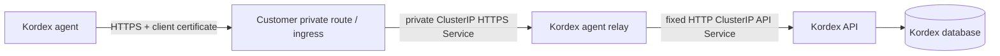

# Private agent relay operations

**Status: implemented locally; not deployed, customer-PKI tested, or qualified.**
The relay supports two explicit modes: the existing management-cluster Service
relay and an opt-in workstation relay for the current M3 lab. Neither mode
creates a private route, firewall rule, DNS record, PKI, or Secret. The
management API remains the authority for agent identity, tenant/cluster
ownership, and operation authorization.

## Request path and authorization



The customer must provide a private route/ingress to the relay Service. The
chart creates only a `ClusterIP` Service; it creates no Ingress, NodePort,
LoadBalancer, public address, VPN, or external gateway. NetworkPolicy source
CIDRs must represent the source as actually observed by the cluster CNI. Some
private ingress implementations SNAT to a node or gateway address; verify this
before configuring `networkPolicy.allowedCIDRs`. NetworkPolicy requires an
enforcing CNI and must be tested with allowed and denied flows.

The relay uses TLS 1.2 or newer and `RequireAndVerifyClientCert`. The client
certificate must chain to the mounted client CA, be valid for client
authentication, and contain exactly one URI SAN. The exact URI SAN string is
looked up in the customer-supplied mapping. An enabled mapping binds it to one
Kordex cluster UUID. Duplicate identity entries, missing mappings, unknown
identities, and disabled entries fail closed.

For signed routes, the relay also requires exactly one value for each existing
`X-Kordex-Version`, `X-Kordex-Cluster`, `X-Kordex-Key`, `X-Kordex-Time`,
`X-Kordex-Nonce`, and `X-Kordex-Signature` header. The cluster header must equal
the certificate mapping. The relay does not create or verify a Kordex
signature. The API verifies the Ed25519 signature, nonce, key identity, active
agent registration, and database ownership as before. On enrollment, the relay
requires the body `clusterId` to equal the mapping and rejects duplicate JSON
fields; the API still validates the single-use enrollment token and Ed25519
proof. No certificate identity header is sent to the API. TLS identity is an
additional network gate, never a substitute for Kordex authorization or
maintenance permit validation.

The relay accepts only these method/path pairs:

| Method | Path | Kordex authorization retained |
|---|---|---|
| `GET` | `/v1/agent/identity` | Ed25519 request signature |
| `POST` | `/v1/agent/enroll` | Single-use token and Ed25519 key-possession proof |
| `POST` | `/v1/agent/rotate` | Existing agent signature and rotation proof |
| `POST` | `/v1/agent/report` | Ed25519 request signature over exact request bytes |
| `POST` | `/v1/agent/operations/sync` | Ed25519 request signature and API operation authorization |

Queries, escaped or noncanonical targets, path traversal, unsupported methods,
unknown paths, invalid JSON enrollment identities, and oversized requests are
rejected. The upstream depends on the explicit relay mode. The default
`cluster` mode accepts only a Kubernetes Service DNS origin
(`http://<service>.<namespace>.svc[:cluster.local]:<port>`). The opt-in
`workstation` mode accepts only the exact loopback API origin
`http://127.0.0.1:8080`; it cannot target another loopback port, a service, or
an arbitrary address. Incoming URL, Host, redirect, and proxy settings cannot
change the upstream; environment proxy variables are ignored. Upstream
redirects are rejected.
Request bodies are forwarded byte-for-byte. For signed requests, only the six
protocol headers above and `Content-Type: application/json` on POST requests
are forwarded. Enrollment carries no `X-Kordex-*` request-signature headers.
Forwarded/remote identity, `Authorization`, cookies, Cloudflare Access,
proxy-authentication, and other headers are rejected or omitted. No trace,
certificate, or secret headers are propagated. Responses are bounded to 64 KiB
and only the API content type is copied back. Secrets and request bodies are
not logged.

## Workstation relay health and connectivity acceptance

In workstation mode the agent-facing listener exposes only the five protocol
routes above. The relay process also binds a separate, loopback-only probe
listener, defaulting to `127.0.0.1:18444`; `KORDEX_RELAY_HEALTH_ADDRESS` may
change the port or loopback IP, but startup rejects non-loopback addresses.
`GET /livez` returns an empty `204`. `GET /readyz` returns an empty `204` only
when the fixed `127.0.0.1:8080/readyz` API probe returns `200`, otherwise it
returns a bounded `503`. Health paths are not available on the relay's
TCP/18443 listener and expose no API response body. Check locally with:

```sh
curl --fail --silent --show-error http://127.0.0.1:18444/livez
curl --fail --silent --show-error http://127.0.0.1:18444/readyz
```

After agent enrollment and customer PKI provisioning, run the agent's
read-only end-to-end identity check from its existing Pod. Supply every
approved private destination CIDR that can be returned by the relay's split
DNS record; the check rejects public, loopback, link-local, unapproved, or
mixed public/private DNS answers and pins its TCP connection to one of the
checked addresses. It reads the mounted agent identity in memory, presents
the configured client certificate, verifies the relay's CA and DNS identity,
and sends the existing Ed25519-signed identity request. It follows no
redirects and emits only bounded JSON status and network metadata:

```sh
kubectl --context "$KORDEX_CONTEXT" -n kordex-system exec deploy/kordex-agent -- \
  /kordex-agent connectivity-check \
  --allowed-cidr 10.84.16.0/24
```

Repeat `--allowed-cidr` for each explicitly approved private relay prefix. The
command uses the Pod's configured control-plane URL, cluster ID, mTLS files,
and projected agent identity. It fails closed if Cloudflare Access headers are
configured for the private relay path. It does not print or return credentials, keys,
certificate content, request headers, or response bodies. Exit code zero and
JSON `status: verified` mean the TLS identity, mTLS handshake, identity route,
configured cluster ID, and Ed25519 key ID were accepted. The certificate
mapping result is inferred from the successful route response; the command
does not read the relay mapping file. A `403` is reported as relay
authorization rejection because that boundary does not distinguish source
CIDR denial from certificate-map denial.

This command is a connectivity acceptance aid, not evidence of live M3 host
maintenance, private-route isolation, or a canonical qualification case.

## Customer PKI and identity mapping

The PKI owner provisions the following in the relay's namespace using the
customer's secret controller or another approved secure channel:

| Secret | Required keys | Purpose |
|---|---|---|
| `tls.serverSecretName` | `tls.crt`, `tls.key` | Relay server certificate chain and private key |
| `tls.clientCASecretName` | `ca.crt` | CA roots that may issue agent client certificates |

The relay server certificate must have a DNS SAN matching the stable private
relay hostname used as both the agent HTTPS URL host and
`KORDEX_MTLS_SERVER_NAME`. The agent independently validates that name against
its separately mounted server CA. Client certificates require clientAuth EKU
and exactly one URI SAN. A recommended identity is
`spiffe://<customer-trust-domain>/kordex/clusters/<cluster-uuid>`; the URI is
an identifier only. The relay mapping, not the URI's textual cluster suffix,
selects the cluster.

Example values (identities and UUIDs are placeholders, not trust material):

```yaml
image:
  repository: registry.customer.invalid/kordex/agent-relay
  digest: sha256:REPLACE_WITH_REVIEWED_64_HEX_DIGEST
api:
  upstream: http://kordex-api.kordex-system.svc.cluster.local:8080
  namespace: kordex-system
  podSelector:
    app.kubernetes.io/component: api
tls:
  serverName: agent-api.customer.internal
  serverSecretName: kordex-relay-server-tls
  clientCASecretName: kordex-relay-client-ca
clientMappings:
  - identity: spiffe://customer.example/kordex/clusters/REPLACE_WITH_CLUSTER_UUID
    clusterId: REPLACE_WITH_CLUSTER_UUID
    enabled: true
networkPolicy:
  allowedCIDRs:
    - 10.84.0.0/16 # Replace with a private RFC1918 IPv4 source range observed at the relay.
```

The chart serializes `clientMappings` into a non-secret ConfigMap. The process
validates each identity and cluster UUID at startup; duplicate identities fail
startup. A mapping ConfigMap change triggers a Deployment rollout. The server
key and CA are never included in Helm values or chart resources. The chart
mounts existing Secrets read-only as UID/GID 65532, uses no Kubernetes API
permissions, disables service-account token automount, and requires a reviewed
image digest.

Customer operations:

1. Issue server and client certificates with short, documented lifetimes.
2. Deliver Secret data through the customer secret-management system, never
   through Git, chat, values files, command-line literals, or ordinary email.
3. Independently distribute the agent's server-CA bundle and the relay's
   client-CA bundle to their respective owners.
4. Keep one mapping per distinct certificate URI SAN. For rotation, add the
   replacement identity before deploying the new client certificate; remove or
   disable the old mapping after clients have moved.
5. Revoke a client by disabling/removing its mapping or removing its issuing
   CA from the trusted bundle, then restart relay Pods. This implementation
   does not fetch CRLs/OCSP and does not dynamically reload certificate files.
   CA and server certificate Secret changes require a controlled relay rollout.
6. Record certificate serials and expiry in the customer's PKI inventory, but
   never log private key contents.

## Install, verify, upgrade, and rollback

Prerequisites: a private path to the management-cluster `ClusterIP`, customer
DNS, an enforcing NetworkPolicy CNI, an already-running internal API Service,
the two Secrets above, a reviewed relay image digest, registered cluster UUIDs,
and customer-approved CIDRs as observed by the CNI. The API Service selector
must match `api.namespace` plus `api.podSelector`; egress allows only that pod
set on `api.port` and the configured DNS pods on TCP/UDP 53.

The service cannot be reached from an external managed site by ClusterIP alone.
The customer supplies and operates whichever private routing/ingress mechanism
their environment supports. Do not change the Service to `LoadBalancer` or
`NodePort` to make it reachable. Confirm that NetworkPolicy enforcement is
active and that no other additive policy broadens access.

Install using the standalone chart after creating a protected values file with
public configuration only:

```sh
helm upgrade --install kordex deployments/helm/kordex-agent-relay \
  --namespace kordex-system --create-namespace \
  -f /secure/customer-config/agent-relay-values.yaml
kubectl -n kordex-system rollout status deployment/kordex-agent-relay
kubectl -n kordex-system get service kordex-agent-relay -o wide
kubectl -n kordex-system get networkpolicy kordex-agent-relay
```

Use the actual Helm release name when deriving resource names. The Service must
show `ClusterIP`; do not print Secret data. Before connecting agents, test from
an approved private client that: no certificate fails, an untrusted or
unmapped certificate fails, a disabled mapping fails, an allowed mapping
reaches only the five routes, a mismatched cluster is rejected, and an
unsigned/invalid Ed25519 request is still rejected by the API. Test a denied
source path and an allowed private route to verify NetworkPolicy enforcement.

For an upgrade, review the chart diff and new immutable image digest, preserve
mapping identity overlap for certificate rotation, run `helm upgrade`, and
verify rollout plus both authorized and denied flows. For rollback, use
`helm history` and `helm rollback` to the reviewed previous chart revision;
restore compatible mappings/Secrets first if the new version changed config.
Keep the API authorization implementation and the agent/operator safety gates
unchanged. Removal is `helm uninstall` for this release only; it does not
remove customer Secrets, private ingress, DNS, CA records, or the API.

The chart uses two replicas, preferred hostname anti-affinity, a PDB, modest
resource requests/limits, TCP probes, non-root UID 65532, read-only root
filesystem, dropped capabilities, seccomp RuntimeDefault, and no RBAC. TCP
probes establish that the listener is accepting connections; they do not
measure API or PKI health. A single-node cluster cannot satisfy the intended
two-replica availability profile. No live customer route, CNI enforcement,
certificate rotation, API signature path, or customer deployment has been
tested. This relay implementation does not qualify M3 host maintenance.

## Workstation relay mode for the M3 lab

The standalone executable also has an explicit `workstation` mode for the
current lab, where the API remains bound to `127.0.0.1:8080`. This is separate
from the Helm chart, which continues to use `cluster` mode and a Kubernetes
Service upstream. Run this mode as a host process in the same network namespace
as the loopback API; an isolated container would interpret `127.0.0.1` as its
own loopback and cannot reach the host API. Workstation mode requires all of
the following:

- An already approved private route from the lab VPC to a workstation private
  interface. The relay does not create a VPN, route, tunnel, DNS entry, or
  firewall rule. A public tunnel or public listener does not meet the M3
  site-local/no-public-egress requirement.
- A listener bound to one explicit RFC1918 IPv4 or IPv6 ULA address assigned
  to the workstation. Wildcard, loopback, public, link-local, and hostname
  binds are rejected.
- `KORDEX_RELAY_ALLOWED_CLIENT_CIDRS` set to the exact private source CIDR(s)
  observed at the workstation socket after routing. The executable rejects
  public, wildcard, noncanonical, duplicate, or missing ranges and checks the
  TCP peer address before forwarding. The workstation host firewall and
  customer route must independently restrict ingress to those same sources.
- The exact upstream `http://127.0.0.1:8080`, a DNS-SAN server certificate for
  the private relay name, a customer client CA, a certificate-to-cluster
  mapping file, and the existing Kordex signature/identity controls.

Example non-secret settings (replace placeholders with customer-approved
addresses and file paths; never put certificate or key contents in environment
values):

```sh
KORDEX_RELAY_MODE=workstation
KORDEX_RELAY_LISTEN_ADDRESS=10.76.0.10:18443
KORDEX_RELAY_API_UPSTREAM=http://127.0.0.1:8080
KORDEX_RELAY_ALLOWED_CLIENT_CIDRS=10.76.0.0/24
KORDEX_RELAY_MAPPINGS_FILE=/secure/customer-config/relay-mappings.json
KORDEX_RELAY_TLS_CERT_FILE=/secure/customer-pki/relay.crt
KORDEX_RELAY_TLS_KEY_FILE=/secure/customer-pki/relay.key
KORDEX_RELAY_CLIENT_CA_FILE=/secure/customer-pki/agent-ca.crt
KORDEX_RELAY_SERVER_NAME=agent-api.lab.customer.internal
```

The workstation DNS name must resolve to the relay's private interface for the
lab, and the server certificate SAN must match that name. Configure the agent
to use `https://agent-api.lab.customer.internal:18443`, its independently
delivered server CA, and its customer-issued client certificate/key. The
workstation firewall permits only the approved routed lab source CIDR to TCP
18443; the only process destination is the loopback API on TCP 8080. Do not
forward dashboard, OIDC administration, health, metrics, database, or other
API routes. The API remains loopback-only. The relay forwards only the five
agent method/path pairs, requires client mTLS and certificate-to-cluster
mapping, and still requires the API's Ed25519 and tenant/cluster checks.

If the route, TLS, or API is unavailable, requests fail; the relay has no
plaintext or public fallback. Agents retry under their existing bounded
backoff. An operation already admitted to the cluster remains governed by its
durable local checkpoints, cancellation, and recovery fencing. This mode has
not been exercised over a real private route or customer PKI and is not a
provisioning approval.
