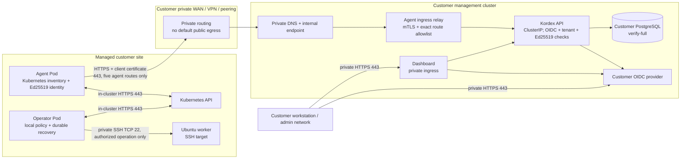

# Private management connectivity architecture

**Status: proposed; not deployed or qualified.** This document describes a
customer-controlled private path for agent and operator traffic. It does not
authorize network changes, Cloudflare configuration, GCP provisioning, or M3
maintenance. The canonical M3 requirements and matrix remain in
[`production-upgrade-requirements.md`](production-upgrade-requirements.md).

## Recommendation

For a customer installation, place a route-restricted agent ingress relay in
the customer management cluster, expose it only on a private service endpoint,
and require customer-PKI mutual TLS from each managed-cluster agent. Keep the
Kordex API behind ClusterIP and keep its administrator routes off the agent
endpoint. The relay accepts only the existing five method/path pairs, forwards
to the internal API, and does not replace Kordex's Ed25519 agent authorization.
Use an existing private WAN/VPN/peering path from each managed site to that
endpoint. This is Option C combined with an already approved private route or
Option D. The relay server and standalone Helm packaging are implemented
locally; the customer route, certificates, image release, and live operation
are not.

This is the most customer-deployable target because the endpoint, CA, private
DNS, firewall, and lifecycle are controlled by the customer and stay with the
management plane rather than a developer workstation. Keep the existing
control-plane, dashboard, agent, and operator boundaries. Do not add an
umbrella chart. The relay should be a small component of the control-plane
installation with its own Deployment/Service and configuration, rather than
a new mandatory external product or database.

The agent now has an opt-in, fail-closed mTLS transport client with customer
mounted certificate files, explicit server CA trust, DNS identity checking,
and no transport fallback. The standalone relay now provides server-side
client-certificate validation, explicit certificate-to-cluster mapping, and
the five-route allowlist. Neither component provides the customer private
route, certificates, or NetworkPolicy enforcement. For
the current M3 workstation-hosted management plane, a customer private route
to the workstation is still absent. The standalone relay now has an opt-in
workstation mode that binds to an explicit private interface, requires an
explicit private source-CIDR allowlist and client mTLS, and forwards only to
the fixed loopback API at `127.0.0.1:8080`. It does not create the route, DNS,
or firewall policy. **There is still no currently verified compliant path for
M3 provisioning.** Cloudflare Access over public internet is not a substitute
for the private route or the site-local/no-public-egress requirement.

## Alternative designs

| Design | Topology and required network policy | TLS/authentication and identity lifecycle | Failure, HA, deployment, and customer burden | Current compatibility / decision |
|---|---|---|---|---|
| A. Customer VPN/private routing directly to management API | Each managed site routes privately to the management API's private address. Firewall permits only source managed-site CIDRs to the API HTTPS endpoint; no default route/public egress. Private DNS resolves the stable management name. | API/ingress must present customer server TLS and require client mTLS. The opt-in agent client mTLS transport is implemented; server-side certificate policy remains customer/relay responsibility. Kordex agent Ed25519 signature, one-time enrollment, cluster ownership, replay checks, and OIDC tenant authorization still apply. Customer PKI issues/rotates/revokes certificates. | VPN/route loss makes API calls fail; the agent retries, local operator checkpoints continue to fence work. HA is the API/ingress/VPN design's responsibility. Exposing the API directly also places every API path behind the VPN; there is no separate method/path allowlist. Customer manages routing, DNS, certs, ingress, firewalls, and support. | Incompatible as a direct network path today: API defaults to loopback on hosts and its K8s Service uses HTTP/8080; the API Service uses HTTP/8080 and a TLS/mTLS terminator is still required. It also exposes broader API paths unless a relay is added. Not recommended by itself. |
| B. Customer private relay beside the workstation management plane | Existing private VPN/route reaches a workstation-side private relay; the relay forwards to the loopback API and permits only five agent method/path pairs. The relay binds to one private interface and checks the observed source against an explicit private CIDR allowlist; the host firewall and route must independently enforce that scope. API, DB, dashboard, Keycloak administration, health, and metrics remain loopback/private. | Relay presents a DNS-SAN server cert and requires customer client mTLS. Agent mTLS, relay certificate-to-cluster mapping, signed cluster-header matching, and enrollment-body matching are implemented locally. Do not use Cloudflare header comparison as if Cloudflare Access had authenticated the private request. Kordex Ed25519 remains end-to-end. Customer controls CA, client certificates, rotation/revocation, and independent bundle distribution. | Workstation/relay/VPN outage disconnects all agents; retries are bounded and local operation state remains fenced. Single relay is a single point of failure; redundancy requires a second protected relay or failover address. The customer installs/patches the relay and maintains workstation availability. | Workstation mode is implemented and locally tested. No VPN, private DNS, host firewall policy, customer PKI, or live network test exists. Requires customer network operations; not ready. |
| C. Private agent relay in the management cluster (recommended) | Customer deploys relay with a private ClusterIP and supplies private routing/ingress to that Service. Relay forwards to API ClusterIP. Its NetworkPolicy restricts configured private source CIDRs, API pods, and DNS. API admin routes are absent from the relay route table. No public LoadBalancer or arbitrary egress is created by the chart. | Relay requires verified customer client certificates and maps exactly one URI SAN to an enabled registered cluster. The agent validates the relay server DNS identity and presents its customer-provisioned client certificate. The relay enforces the five-route allowlist. API still checks Kordex signature/proof, nonce, agent identity, cluster ownership, and tenant authorization. Client certificate rotation/revocation is customer PKI responsibility. | The standalone Go relay and Helm chart are implemented locally with two replicas, PDB, resource bounds, non-root/read-only security, and no RBAC. Customer supplies private ingress/routing, DNS, NetworkPolicy enforcement, and Secrets. API/DB availability remains separate. Relay failure yields bounded errors; no plaintext fallback. | Recommended. Local synthetic mTLS/route/mapping tests exist. No customer PKI, image release, private route, live NetworkPolicy test, or customer deployment has been performed. See [relay operations](private-agent-relay-operations.md). |
| D. Customer-managed private service endpoint (PrivateLink/PSC or equivalent) | Provider-managed private endpoint connects a consumer VPC/site to a customer-published private service. Firewall/route policy still restricts consumer CIDRs to the endpoint and port; DNS maps the service name to the private endpoint. The endpoint normally fronts design C's relay, not the full API directly. | Provider networking does not replace TLS. Use customer server cert matching private DNS and mTLS client identities, plus all Kordex application authorization. Customer owns endpoint service policy, PKI, DNS, and certificate lifecycle. | Can simplify cross-VPC/customer connectivity and avoids a public endpoint, but provider-specific setup, quotas, endpoint lifecycle, monitoring, and data-processing/endpoint charges add operational work. Regional failure and endpoint-service availability must be tested; HA requires multi-zone/backends and customer failover. | Compatible as the transport for design C if the chosen cloud/customer platform supports it and policy permits it. It is not a Kordex feature and no endpoint/service exists. Do not create one before explicit customer approval and pricing. |

None of these choices is made for the customer. For the present M3 lab, B
would require an existing private route and a workstation-side relay;
agent mTLS and the management-cluster relay are implemented locally but have
not been tested against customer PKI or a private route. C is the recommended
customer deployment target. D may carry C across private network
boundaries but is an infrastructure choice, not a substitute for C's
application controls. A direct VPN to the full API is broader than necessary.

## Current request paths and security

### Agent control and inventory

The agent runs inside each managed cluster. It uses the in-cluster Kubernetes
API, collects inventory, and makes outbound HTTPS calls to the configured
management API. `agent/internal/client` limits calls to these exact routes:

| Method | Path | Current request authentication |
|---|---|---|
| `GET` | `/v1/agent/identity` | Ed25519 request signature, cluster ID, key ID, timestamp, nonce |
| `POST` | `/v1/agent/enroll` | Single-use Kordex enrollment token plus Ed25519 key-possession proof |
| `POST` | `/v1/agent/report` | Ed25519 signature over method, escaped path, cluster ID, key ID, timestamp, nonce, and body SHA-256 |
| `POST` | `/v1/agent/rotate` | Current identity signature and proof of possession of the replacement key |
| `POST` | `/v1/agent/operations/sync` | Ed25519 request signature; used only when the agent maintenance bridge is enabled |

The API checks active identity, cluster scope, time window, nonce/replay state,
and organization/cluster ownership before accepting an operation. The runner
reports on a 30-second default interval and retries with bounded exponential
backoff. It persists identity/key state before requests. There is no inbound
connection from the control plane to an agent Pod.

The prepared `integrations/agentgateway` proxy has a fixed API upstream,
accepts only the routes above, strips Cloudflare/forwarding headers, rejects
query strings and noncanonical paths, and binds only `127.0.0.1:18443`. The API
defaults to `127.0.0.1:8080` on a host; the Kubernetes API chart binds the API
inside its Pod and exposes an internal ClusterIP Service on port 8080. The
standalone `integrations/agentrelay` preserves the fixed Kubernetes-Service
upstream for its default cluster mode and provides a separate workstation mode
whose only upstream is `http://127.0.0.1:8080`. The latter binds only to an
explicit RFC1918/ULA address and enforces an explicit private peer-CIDR
allowlist. Neither mode exposes a configurable upstream to requests. The
agent supports legacy server CA trust (`KORDEX_CA_FILE`) and normal hostname
verification. Its opt-in mTLS mode requires a customer client certificate/key,
server CA, and DNS name matching the HTTPS origin; it verifies the server and
presents that client identity. The relay and server-side certificate-to-cluster
mapping are implemented locally but have not been live-verified. In gateway mode it
sends a configured `CF-Access-Client-Id` and `CF-Access-Client-Secret`; the
gateway compares those values itself. Cloudflare's Access edge separately
checks the service token only when the request traverses that edge.

### Operation execution and result reporting

When maintenance is enabled for the selected disposable spoke, the agent polls
`/v1/agent/operations/sync`, places signed operation envelopes into its durable
Kubernetes CRD inbox, and reports operator status/checkpoints through the same
sync route. The operator watches Kubernetes resources and applies local
admission, permit-signature, target, policy, and veto checks. For self-managed
host execution it makes an outbound SSH connection from the operator workload
to the selected worker's private address on TCP/22 using customer-provisioned
SSH credentials and pinned `known_hosts`.

The operator does not need a route back to the management API. If hub
connectivity fails after an operation has reached the cluster, local durable
checkpoints, fencing, and recovery rules remain authoritative; loss of
connectivity does not authorize replay or a second mutation. Results can be
reported after connectivity returns. Both agent maintenance and operator host
execution remain disabled by default and may be enabled only in the reviewed
disposable lab.

### Management-plane paths

The control-plane API authenticates administrator calls through configured
OIDC and organization membership/role checks. Bootstrap-token mode is isolated
for local development. The API serves many administrator routes, so it must
not be exposed on the agent endpoint. In Kubernetes, API and dashboard have
separate Services/charts; the API Service is ClusterIP by default, and the
existing optional API Ingress routes `/` to the API. The dashboard calls the
API server-side. API database traffic uses PostgreSQL TLS with
`sslmode=verify-full`; API and dashboard need trusted OIDC discovery/JWKS and
token endpoints. The dashboard browser redirects to the customer's OIDC
provider over HTTPS.

## Proposed network topology

For the current workstation-hosted lab, run the standalone relay in its
opt-in workstation mode on one workstation private interface behind an
already-approved private route. It binds to that private address, enforces a
configured source CIDR allowlist, and forwards only to the loopback Kordex API
at `127.0.0.1:8080`. It must not expose the API, dashboard, PostgreSQL,
Keycloak administration, or metrics listener. The relay code exists locally;
the private route, DNS, firewall policy, customer PKI, and live connectivity
do not. The lab relay configuration uses TCP/18443; the customer-deployed
management-cluster relay may use its approved private HTTPS endpoint on TCP/443.

## Required flows

These are target flows, not currently configured firewall rules. Use the
customer's actual private CIDRs and endpoint addresses; do not invent public
service IP ranges. Restrict NetworkPolicy and VPC/firewall rules at the layers
that can enforce each path. A hostname in a firewall rule is not a strong
destination control.

| Source | Destination | Protocol / port | Purpose and control |
|---|---|---|---|
| Agent Pod | Private agent endpoint DNS name | TCP/443 HTTPS with mTLS | Outbound only; exact five method/path pairs; agent validates server CA/SAN and presents a per-agent client cert; Kordex Ed25519 authorization remains mandatory. |
| M3 lab VMs | Workstation relay private DNS name/address | TCP/18443 HTTPS with mTLS | Workstation relay mode; destination must be in the approved customer RFC1918 CIDRs and reachable over the customer private route. This is not a public endpoint. |
| Private ingress relay | API ClusterIP | TCP/8080 in-cluster, or a customer TLS-proxy port if configured | Only relay may reach the API from the agent ingress path. API admin endpoints stay off the relay's route allowlist. Use NetworkPolicy and a private Service; do not rely on the Service alone as authorization. |
| Dashboard Pod | API ClusterIP | TCP/8080 in-cluster | Server-side organization-scoped API access; no browser-to-database path. |
| API Pod | PostgreSQL private Service/endpoint | TCP/5432 TLS | `sslmode=verify-full`; certificate SAN must match the configured database hostname; trust only customer CA. |
| API and Dashboard Pods; browser | OIDC issuer endpoints | TCP/443 HTTPS (or private service port with TLS) | Discovery/JWKS/token endpoints and browser authorization redirect. Issuer URL, token issuer, DNS, and certificate SAN must match exactly. |
| Agent and Operator Pods | Their own cluster API server | TCP/443 HTTPS | Kubernetes API access using the workload service account and least-privilege RBAC. This stays within the managed cluster. |
| Operator Pod/node source | Selected worker private IP | TCP/22 SSH | Only for an approved self-managed maintenance operation; pinned host key, scoped SSH user/sudo, and reviewed EE. Restrict source to the operator's actual egress identity/CIDR. |
| Lab VMs during bootstrap | Customer internal K3s artifact mirror | TCP/443 HTTPS | Exact approved K3s artifact lock/digest; no redirects; mirror hostname certificate validation. |
| Lab VMs / K3s runtime | Customer internal OCI registry or offline image bundle | TCP/443 HTTPS, or approved local registry port | Digest-pinned agent/operator/EE and required K3s system images. Registry credentials are Secret references, not values or metadata. |
| Lab VMs during bootstrap | GCE metadata server `169.254.169.254` | TCP/80 HTTP on the link-local metadata path; TCP/UDP 53 to the platform resolver as required | Read instance metadata and obtain the narrowly scoped VM service-account token for Secret Manager if that bootstrap path is retained. This is not public internet egress. |
| Lab VMs during bootstrap only | Customer internal Ubuntu package mirror or staged package bundle | TCP/443 HTTPS if using a private HTTPS mirror; otherwise no network flow during offline install | Stage dependencies and package metadata before the maintenance phase. During installation/recovery, public package repositories remain denied. |
| Agent/Operator nodes | Customer internal DNS resolver | UDP/TCP 53 | Resolve only approved private service names; do not use unrestricted public recursive DNS from the lab. |
| Lab/managed hosts | Customer internal time source | UDP/123 or approved time protocol | Keep timestamps within Kordex's signature window; time source must be private or locally staged/managed. |
| Lab VM service identity (only if Secret Manager bootstrap is retained) | Restricted Google APIs VIP `199.36.153.4/30` through Private Google Access | TCP/443 HTTPS | The lab profile uses private DNS mapping `*.googleapis.com` to `restricted.googleapis.com`, Private Google Access, and a /30-specific firewall allow for Secret Manager. This is Google API access without general Internet egress. The Cloud DNS API must be explicitly enabled and private DNS resolution verified. |
| Workstation admin | Lab VM via IAP, if that approved GCP lab path is retained | IAP-mediated TCP/22 | Ingress is limited to IAP's documented source range and OS Login/IAM; VM has no external IP. This is administration, not agent-to-hub connectivity. |
| K3s Server | Workers and workers to server | TCP/6443, TCP/10250, UDP/8472 within the dedicated lab subnet | K3s control plane, kubelet, and Flannel; exact rules depend on the chosen K3s topology and must be checked against the pinned version. |

There is no required public TCP/443 egress from the qualification VMs in the
target design. If a dependency cannot be staged on an internal mirror or
reached over an approved private endpoint, stop and make a design decision;
do not add `0.0.0.0/0:443` as a convenience. Public release acquisition and
customer approval happen before the lab window, then approved bytes are
transferred to the private mirror or offline bundle.

## Authentication and trust boundaries

The target adds an outer customer-managed mTLS boundary; it does not replace
Kordex authorization:

1. The customer PKI issues a server certificate for the private agent endpoint
   and a distinct client certificate for each agent installation. The client
   certificate should include a customer-defined URI SAN bound to the
   registered cluster identity. The issuer, key use/EKU, SAN rules, lifetime,
   rotation, and revocation are controlled by the customer.
2. The agent verifies the endpoint certificate chain and hostname and presents
   its client identity. The implemented `KORDEX_MTLS_*` mode uses an explicit
   customer CA bundle and client certificate/key files; it is loaded at
   startup, so certificate rotation requires an agent restart. The older
   `KORDEX_CA_FILE` setting remains for the explicitly non-mTLS transport.
3. The relay requires a valid client-auth certificate from the configured
   customer trust bundle. It maps the certificate identity to an allowed
   registered cluster and permits only the method/path pairs above. It rejects
   expired, revoked, wrong-purpose, unknown-issuer, or mismatched identities
   without a plaintext or Cloudflare fallback.
4. The relay strips client-supplied forwarding and identity headers and does
   not assert an OIDC subject, organization, role, or Kordex agent identity.
   It must not trust arbitrary `X-Forwarded-Client-Cert` or user-supplied
   identity headers. The API verifies the request signature, active agent key,
   timestamp, nonce, body digest, cluster ID, and database ownership as it
   does today.
5. Kordex enrollment remains an administrator-authorized, single-use,
   short-lived token plus Ed25519 proof. The mTLS certificate does not create a
   cluster, membership, or role. The API continues to require OIDC membership
   and roles for administrator APIs.

The agent's Ed25519 key remains durable in the existing identity Secret and
is rotated through the existing Kordex protocol. The TLS client private key is
a separate customer PKI credential, mounted only into the agent from a Secret
or external secret provider. Do not place it in ConfigMaps, Helm values,
container images, or Terraform state. cert-manager and OpenBao can be optional
customer integrations; neither is required by the architecture.

Use customer-approved short certificate lifetimes and a renewal/revocation
process. The relay must support trust-bundle overlap for CA rotation and an
explicit revocation response. Offline sites need an agreed CRL/denylist refresh
or short-lifetime expiry policy; OCSP must not become an unplanned public
dependency. Rotate server and client trust with overlap, test both current and
next credentials, then remove old trust only after all agents have moved.

TLS terminates at the relay. Its internal API hop remains inside the
management cluster and is restricted to the relay by NetworkPolicy; the API
continues to validate Kordex signatures, so a relay cannot forge an agent
request or a maintenance permit. A compromised relay can still observe,
drop, delay, replay, or alter traffic and cause denial of service. API replay
protection rejects reused signed requests, and the operator independently
checks signed permits and local safety. Restrict relay service-account access,
disable shell/exec, run non-root/read-only, pin its image, minimize API network
reachability, and audit certificate identity and route decisions without
logging credentials or request bodies. If the customer's threat model requires
encryption of the relay-to-API hop, add a customer-trusted TLS proxy/sidecar on
the API Service and verify its certificate; that is an additional component
and test, not current behavior.

The private service endpoint should pass TLS through so the relay validates
the client certificate itself. If a customer ingress must terminate TLS
before the relay, it must authenticate the relay-to-relay hop, strip all
client-supplied identity/forwarding headers, and convey verified certificate
identity over a trusted channel; do not accept a naked forwarded-certificate
header from arbitrary callers. The pass-through design is preferred because
it avoids making a proxy header part of Kordex's trust boundary.

The private service endpoint should pass TLS through so the relay validates
the client certificate itself. If a customer ingress must terminate TLS
before the relay, it must authenticate the relay-to-relay hop, strip all
client-supplied identity/forwarding headers, and convey verified certificate
identity over a trusted channel; do not accept a naked forwarded-certificate
header from arbitrary callers. The pass-through design is preferred because
it avoids making a proxy header part of Kordex's trust boundary.

## Private/offline dependency plan

The private network design is not complete until every dependency is present
inside the approved private trust boundary:

- **K3s:** customer custodian approves the exact binary and signs the artifact
  lock; mirror those exact bytes internally and verify the signed lock, digest,
  architecture, and version before bootstrap. Customer approval is not upstream
  provenance.
- **Ubuntu maintenance packages:** deliver the signed package/policy bundle
  to the workers or serve it from a customer-controlled private APT mirror.
  Include dependency closure and metadata; run the maintenance phase with
  public repository access denied. A package mirror is not trusted merely
  because it is internal.
- **Container images:** copy release-approved digest-pinned agent, operator,
  execution-environment, and required K3s system images to a private OCI
  registry or offline image bundle. Verify signatures/digests before import.
  Create pull credentials through the customer's secret process.
- **DNS and time:** provide private records for the agent endpoint, API,
  dashboard, PostgreSQL, OIDC, mirrors, registry, and time service. Preserve
  the OIDC issuer's exact hostname. Deny fallback to arbitrary public DNS/NTP.
- **TLS and trust:** distribute only public CA roots and verified public
  signing bundles through a customer-controlled channel. Private keys stay in
  customer PKI/secret systems; TLS certificate SANs match each configured
  service name.
- **Google bootstrap services:** the current lab uses Secret Manager for a
  short-lived K3s join token. If retained, provide a private Google API path
  and private DNS to it, with service-account access scoped to the one secret.
  Otherwise design and review an alternative runtime handoff. Do not enable
  general internet egress for this API call.
- **Telemetry:** disabled by default. If enabled, the collector is another
  explicitly approved private destination; it is not a reason for wildcard
  egress.

Before execution, test allowed traffic and deny arbitrary public IPs, public
package repositories, unapproved registry/mirror names, redirects, and DNS
fallback. Preserve firewall, DNS, proxy, and flow logs. Do not claim offline
qualification from a connected bootstrap.

## Customer deployment and operations

| Component | Customer placement and responsibility |
|---|---|
| Control-plane API and scheduler | Customer management cluster, separate existing Helm release/chart; API Service remains ClusterIP. Configure customer PostgreSQL, OIDC issuer/audience, maintenance signer, internal network policy, migrations, backup, and private API service. |
| Dashboard | Separate existing Helm chart in management cluster. Expose only through customer private ingress; configure server-side API URL and OIDC; browser receives no Kubernetes or agent credentials. |
| Private agent ingress relay | Proposed component in the control-plane installation. Customer deploys TLS server identity, client CA trust, route map, resource limits, readiness, NetworkPolicy, private Service/ingress, and cert rotation. No public LoadBalancer. |
| Agent | Existing Helm chart or supported Kustomize spoke overlay, installed once per managed cluster. Customer supplies registered cluster ID, private HTTPS endpoint, server CA, client cert Secret (future support), one-time enrollment Secret, registry Secret, and private DNS/routes. Agent has no inbound service exposure. |
| Operator | Existing Helm chart or supported Kustomize component in each managed cluster. Inventory/maintenance APIs remain default off; RBAC, public maintenance trust bundle, SSH Secret, pinned known_hosts, EE digest allowlist, and explicit lab-only execution settings are customer administered. |
| PostgreSQL and OIDC | Customer-operated services. Maintain TLS, backups/PITR policy, credentials, issuer continuity, signing trust, and independent disaster recovery. Kordex does not silently provision them. |
| PKI, registry, DNS, routing and package mirror | Customer-operated or approved existing enterprise services. cert-manager, OpenBao, service mesh, and GitOps are optional integrations, not Kordex prerequisites. |

Use existing separate Helm charts/Kustomize paths; an umbrella chart is not
needed to establish the private network boundary. The relay may be packaged as
an opt-in component in the control-plane chart while preserving current
install behavior. Keep evaluation, enterprise, and disconnected profiles
explicit; never silently generate production signing keys, client identities,
database credentials, or OIDC secrets.

For relay upgrades, pin and verify the image digest, render and review the
route/NetworkPolicy changes, preserve old/new CA overlap, roll out with a
PodDisruptionBudget where replica count permits, test authenticated and denied
routes, then remove old trust. Rollback restores the previous image and trust
bundle without undoing Kordex database migrations or revoking the only active
agent certificate. Keep the private endpoint DNS name stable across upgrades.
For a single-replica M3 lab, outage is expected and operations remain locally
fenced; it is not HA qualification.

## Repository implementation proposal

The agent transport stage is implemented locally; the relay and customer route
are not. Continue in bounded stages:

1. **Agent mTLS transport — implemented locally:** the Go client loads explicit
   customer certificate/key files, a dedicated server CA bundle, and expected
   DNS name; it rejects incomplete or invalid material, verifies server chain
   and DNS identity, and never falls back when enabled. Helm values and an
   opt-in self-managed Kustomize patch mount externally provisioned Secrets.
   Existing Ed25519 identity, signatures, nonce/timestamp, and explicitly
   disabled legacy transport remain intact. Synthetic certificate tests do
   not verify real customer PKI or a relay.
2. **Private relay mode:** extend the existing fixed-route gateway or add the
   smallest gateway component to the control-plane chart. Add an explicit
   `mtls` mode separate from the existing `cloudflare-access` mode; require
   mTLS, map certificate identity to registered cluster, apply exact
   route/method allowlisting, use a fixed internal API destination, strip
   untrusted forwarding/auth headers, and fail closed. The API destination
   must be a validated deployment setting, never a request-derived URL. There
   must be no automatic fallback between modes. Do not make a listener public
   or trust a VPN source alone.
3. **Packaging and policy:** add customer Secret references and an internal-only
   Service/Ingress option to the existing Helm/Kustomize packaging. Add
   component-scoped NetworkPolicies for relay-to-API, management dependencies,
   and agent-to-private-endpoint flows. Defaults stay safe and all egress
   destinations are explicit. Do not require a specific CNI, PKI provider,
   ingress controller, service mesh, or secret manager.
4. **Lifecycle:** document customer issuance, cluster binding, rotation,
   revocation, CA overlap, and emergency disable. Keep PKI identity separate
   from Kordex enrollment, agent Ed25519 identity, OIDC roles, and maintenance
   signing keys.
5. **Qualification:** test route allow/deny, mTLS wrong/missing/expired/revoked
   certificates, wrong SAN/CA, agent signature/replay failures, cluster
   mismatch, certificate rotation, private DNS failover, relay outage, and
   recovery when hub connectivity disappears during a live operation.
   Perform live tests only on an approved disposable lab.

Backward compatibility is a migration concern: keep the existing direct HTTPS
and separately configured Cloudflare gateway modes available during a
customer migration, but never silently fall back from required mTLS to
plaintext, public Access, or unauthenticated access. A rollout first adds the
private endpoint and trust, then enrolls/rotates agents, then removes obsolete
routes only after customer verification.

### Complexity and cost

Remaining repository work is medium: gateway mTLS and certificate-to-cluster
policy, relay deployment/route tests, and live qualification. Customer
operations are medium-high: PKI issuance and
revocation, private DNS/routes, private ingress and policy enforcement, image
and package mirroring, and certificate rotation. A private route or endpoint
may require VPN/peering/Private Service Connect/internal load-balancer
resources and can incur continuous and data-processing charges. A registry,
proxy, and private Google API endpoint may also have recurring costs.

The updated planning estimate of about `$0.87` for four hours and `$1.74` for
eight hours covers three VMs, their 40-GiB balanced disks, and one short-lived
private Cloud DNS zone; the module no longer includes Cloud NAT or a public
HTTPS allow. It excludes the customer private route/VPN, relay, registry,
mirror, PKI service, DNS queries, and transfer. It is not a
spend cap or billing evidence. Price the selected customer's existing or new
network services before approval and keep total M3–M6 spending within `$300`.
Avoid always-on components; destroy temporary lab resources and verify actual
billing after each session.

## Customer decisions and remaining gates

1. Identify the customer management-cluster/site and whether it can host the
   private agent relay, or confirm the current M3 workstation-hosted design
   must remain and provide its existing private VPN route plus an approved
   loopback relay.
2. Name the customer network owner, PKI owner, private DNS owner, mirror/OCI
   registry owner, and independent security reviewer. Confirm they will issue
   per-agent client certificates and manage rotation/revocation.
3. Choose private route technology and exact private CIDRs/endpoints. Approve
   routes/firewall/NetworkPolicy and determine whether the current lab's
   Secret Manager bootstrap requires a private Google API endpoint.
4. Confirm the API/OIDC/PostgreSQL endpoint names and CA chains; preserve exact
   OIDC issuer equality. Identify internal DNS and time sources.
5. Confirm internal K3s, package, OCI, and EE artifacts and their independent
   trust roots. No artifact or signing key is fabricated by this proposal.
6. Approve the customer-owned deployment and cost estimate separately from
   any Terraform plan/apply and migration authorization.

The management-cluster relay and workstation relay modes are present locally,
but no customer route, certificate, image release, CNI enforcement, or customer
deployment has been verified. The current workstation lab still has no private
route. Until private connectivity, offline dependencies, and recovery controls
are implemented and independently tested,
the M3 lab is **NOT READY FOR PROVISIONING APPROVAL**. No live route, customer
certificate, relay deployment, GCP service, or qualification result is
established by this document.
