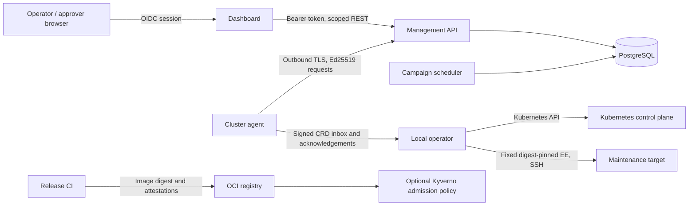

# Kordex threat model

This document describes the current Kordex trust boundaries, protected assets,
attack scenarios, implemented controls, and residual risks. It is based on the
repository implementation as of 2026-11-19. It is an engineering threat model,
not an independent security assessment or a production approval. The [security
model](security.md), [signed agent protocol](agent-protocol.md), [maintenance
authority boundary](KORDEX-SECURITY-MODEL.md), and [failure recovery
contract](failure-recovery.md) remain the detailed behavior references.

## System boundary

The hub coordinates work and stores inventory, plans, approvals, audit events,
and operation checkpoints. The cluster-local operator is the final maintenance
authority. The agent cannot patch nodes, evict pods, or execute host commands.
The dashboard is a client of the API, not an authorization authority. The
optional image admission policy is separate from application installation and
is not installed by default.

## Protected assets

| Asset | Security objective |
|---|---|
| Tenant inventory, policies, campaign plans, approvals, and evidence | Prevent cross-organization disclosure or mutation; preserve attribution and integrity |
| Agent private keys, enrollment tokens, and identity records | Prevent impersonation, replay, unauthorized enrollment, or silent identity replacement |
| Hub maintenance signing key and operator trust bundle | Prevent forged or overbroad maintenance authorization |
| SSH private keys, known-hosts data, and execution artifacts | Restrict host access to approved targets; prevent credential disclosure or execution substitution |
| Node availability, package state, boot identity, and workloads | Prevent unauthorized disruption and unsafe automatic continuation after uncertainty |
| PostgreSQL records and audit checkpoints | Preserve durable state, tenant relations, and verifiable history |
| Release images, manifests, and offline bundles | Prevent unreviewed or substituted software from being deployed |
| OIDC sessions and organization memberships | Prevent session theft, role escalation, and tenant crossover |

## Trust boundaries and assumptions

1. **Browser to dashboard.** The browser is untrusted. The dashboard keeps API
   tokens in an encrypted, HTTP-only session cookie and proxies only
   allowlisted organization-scoped routes. The deployment must protect the
   session encryption key, HTTPS origin, and OIDC client configuration.
2. **Dashboard and human identity to API.** The API validates configured OIDC
   issuer, signature, algorithm, audience, expiry, and token-mode-specific
   claims. It loads membership and role from PostgreSQL for each request. The
   OIDC provider and its signing-key publication are trusted dependencies.
3. **Agent to API.** TLS protects transport and verifies the hub. Ed25519
   signatures authenticate enrolled agents across TLS termination. PostgreSQL
   nonce reservation, identity expiry, cluster binding, and transactional
   writes are authoritative. Clocks must remain within the protocol's bounded
   skew.
4. **Agent to local operator.** Kubernetes API objects carry signed permits.
   The agent can create the inbox object and acknowledge it, but cannot write
   operation status or perform disruption. The operator checks signatures,
   exact target and plan identity, expiry, cancellation, and local safety.
5. **Operator to Kubernetes and host.** The Kubernetes API, operator binary,
   its trust configuration, and the configured SSH trust/key material are
   trusted. A Kubernetes cluster administrator or node-root attacker can alter
   these controls; Kordex does not claim to defend against a fully compromised
   cluster control plane or target host.
6. **Release pipeline to registry and admission.** The GitHub repository,
   release workflow identity, signing service, registry, and (when installed)
   Kyverno controller are trusted. The release workflow and admission policy
   have not been qualified against a published Kordex release in a live
   cluster.
7. **Database and audit export.** Runtime database credentials should have
   narrower grants than migration credentials. Hash chaining detects changes
   relative to a separately retained checkpoint, but a database owner who can
   rewrite all rows can recompute the chain. Independent immutable checkpoint
   retention is a deployment requirement.

## Threat scenarios and current treatment

| ID | Threat scenario and impact | Implemented controls and evidence | Residual risk |
|---|---|---|---|
| TM-01 | A user changes an organization ID or resource UUID to read or mutate another tenant's inventory, campaign, approval, or evidence, or a malformed identity value aliases a tenant membership. | API authorization resolves organization membership and role on each request; tenant-scoped store queries and cross-tenant tests exist. OIDC subjects are constrained to 1–255 printable ASCII bytes before membership lookup and audit attribution. Dashboard binds its proxy organization to the authenticated session and allowlists paths/methods. | Independent review and exhaustive authorization testing of every new endpoint, aggregate, and concurrent evidence path remain necessary. |
| TM-02 | A campaign creator, editor, or starter approves their own destructive plan, or an approval is reused after plan changes. | Approval is separated from creator/editor/starter identity and binds plan generation, stage, approval epoch, and snapshot digest. Material plan changes invalidate the approval. | Compromise of distinct approving identities or organization administration remains possible. Operational identity proofing, MFA policy, and provider-backed role mapping are deployment dependencies. |
| TM-03 | A compromised hub or scheduler signs a malicious node action or targets a different node/plan. | Local operator verifies hub signatures and independently checks action, immutable cluster/node identity, policy/plan digest, expiry, cancellation, local health, workload safety, and reservation ownership before side effects. Unknown safety evidence blocks. | A stolen hub signing key can authorize within the implemented action envelope. Key custody, rotation drills, and real-world local-veto qualification remain incomplete. The cluster administrator can replace local trust/configuration. |
| TM-04 | An attacker replays or reorders agent requests, enrollment, or operation delivery. | Enrollment tokens are single-use and short-lived; signed requests bind method/path/body/time/nonce; nonces are transactionally stored; key rotation and revocation are fenced; operations and checkpoints have stable IDs and sequence checks. | Production clock discipline, database failover behavior, and long-duration replay/fault testing are not qualified. |
| TM-05 | A timeout or lost response causes duplicate package installation, reboot, or reservation release while the first action may still be running. | Durable operation/checkpoint state, action markers, boot-ID checks, fixed read-only inspection, explicit `RecoveryRequired`, and no blind retry on ambiguous outcomes. Reservations are not freed by timeout alone. | No real VM family has completed the package/reboot failure matrix. Physical exactly-once mutation is not promised; operator intervention may be required. |
| TM-06 | A forged SSH host, stolen SSH key, mutable EE image, or substituted playbook runs host commands or exfiltrates credentials. | Fixed Ansible catalog and entrypoint; allowlisted image digests; strict known-hosts verification; explicit SSH identity; credential redaction; EE execution is separately gated and its RBAC is opt-in. No general remote shell API exists. | SSH account privileges and host-key provisioning are deployment-owned. Secret encryption at rest, private registry access, image signature admission, and actual EE isolation have not been live-qualified. |
| TM-07 | A stolen browser session, CSRF request, URL normalization trick, or upstream redirect steals a bearer token or performs an unintended mutation. | OIDC authorization-code flow with PKCE, nonce/state, encrypted HTTP-only same-site cookies, secure production origin requirements, origin checks for mutations, canonical route allowlist, bounded streaming bodies, and manual redirect refusal. | Dashboard key rotation/revocation, reverse-proxy behavior, browser security headers in each deployment, and external identity-provider integration still require deployment testing. |
| TM-08 | A database or privileged database operator alters operation history or fabricates audit evidence. | Append-only triggers and per-organization hash chains protect ordinary writes; export verifier checks links and a separately supplied final checkpoint; backup/restore helpers verify schema history and archives. | Database owner/superuser can rewrite data and recompute the chain. Independent immutable audit export and production privilege separation/restore drills are not complete. |
| TM-09 | A compromised dependency, CI identity, tag, or registry publishes a malicious Kordex image that is deployed as trusted. | Runtime base images are digest-pinned; release path is manually gated, scans and generates SBOM/provenance before signing/tagging; production Helm profiles require digest references; opt-in Kyverno policy verifies the expected keyless workflow identity and digest. | Release pipeline has not published a Kordex release; the policy has only CLI simulation, not live admission testing. Provenance/SBOM are not admission-enforced, and a compromised authorized workflow can still produce an accepted signature. |
| TM-10 | Stale or forged inventory, partial capability discovery, or an unavailable dependency is treated as healthy and permits maintenance. | Freshness is explicit; capabilities distinguish observed/unknown; stale, missing, conflicting, and unsupported evidence fails closed; node display strings do not qualify host OS identity. | Inventory remains advisory and cluster-specific compatibility is unqualified. Incorrectly trusted Kubernetes or host evidence can still mislead operators. |
| TM-11 | A compromised cluster administrator tampers with CRDs, leases, service accounts, trust bundles, Secrets, or operator deployment to bypass safety or steal keys. | Separate agent/operator RBAC, scoped execution component, nonroot/read-only containers, explicit ownership/finalizers, signed permits, audit checkpoints, and opt-in explicit-peer egress policies for hub and spoke workloads limit ordinary workloads. | Cluster administrators and control-plane/root compromise are inside the trusted computing base. Secret encryption, admission enforcement, runtime monitoring, site-specific egress rules, and CNI enforcement depend on customer deployment. |
| TM-12 | A malicious or compromised cluster causes cross-cluster impact through shared credentials, broad cloud permissions, provider identity, or a faulty adapter. | Provider adapters are separate from Kubernetes API maintenance; provider actions are explicit and opt-in; GKE path checks target identity/settings; EKS/AKS adapters are absent rather than implicitly allowed. | GKE integration is unqualified. Least-privilege workload identity, provider failure recovery, and conflicting provider/host executor exclusion need real provider qualification. |
| TM-13 | Denial of service or database/network interruption causes duplicate work, stale readiness, or silent loss of maintenance state. | Bounded request sizes/deadlines, retry backoff, PostgreSQL row locks/epochs, scheduler health probes, durable operation storage, and fail-closed freshness/reservations. | Production HA, load targets, global rate limiting, network partition recovery, PITR, RPO/RTO, and multi-replica fault behavior are unmeasured or unqualified. |
| TM-14 | Offline artifact transfer or restricted-network installation substitutes an image/package or bypasses trust validation. | Offline bundles have detached Ed25519 signatures and digest manifests; package artifacts are checksum-validated; the installer supports private registries and explicit trust inputs. | A complete install and host transaction with external network disabled has not been qualified. Trust-key distribution and local registry/repository operations remain customer responsibilities. |

## Security invariants for changes

- The hub may request an operation but cannot override local operator checks.
- Destructive authorization binds one operation, organization/cluster/node,
  action, exact plan, approval generation, and bounded validity interval.
- Unknown, stale, conflicting, or unqualified safety input must deny mutation.
- An uncertain action remains fenced until read-only evidence or explicit
  operator intervention resolves it; timeout is never proof of non-execution.
- Tenant identity comes from verified authentication and server-side membership,
  never from a caller-supplied organization field alone.
- No API, CRD, playbook, or provider adapter may become an arbitrary command
  execution channel.
- Repository defaults for host upgrades and provider maintenance remain off;
  local tests, simulators, and manifest renders do not qualify real systems.

## Required follow-up evidence

1. Independent security review of authorization, signing-key custody, operator
   RBAC, SSH execution, and supply-chain controls.
2. Automated tenant-isolation tests spanning all API resource families,
   campaign concurrency, approvals, and evidence export.
3. Live release image signature verification and Kyverno admission test using
   an actual signed, digest-pinned Kordex release.
4. Disposable Ubuntu host-upgrade failure matrix, followed by separately
   authorized OS/provider qualification; no production gate may be enabled
   before evidence meets `production-upgrade-requirements.md`.
5. Production database credential separation, immutable external audit
   retention, backup/restore, and multi-replica scheduler/API recovery drills.
6. Restricted-egress and disconnected installation tests with the selected
   customer CNI, ingress, identity, registry, and package repository.
